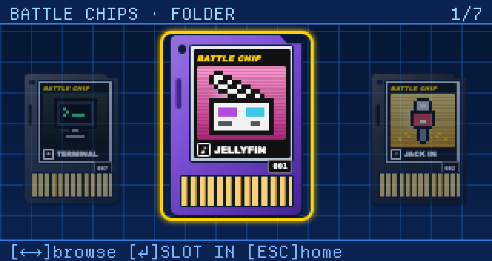
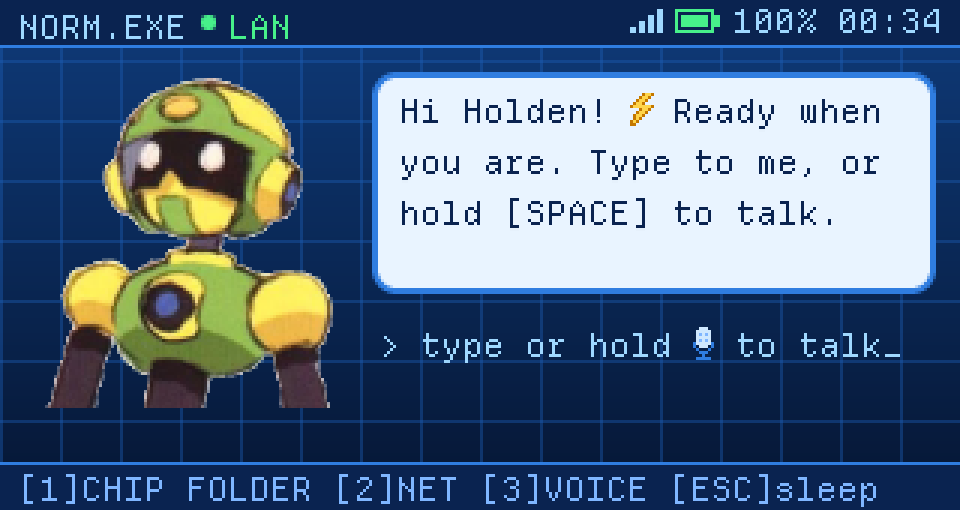
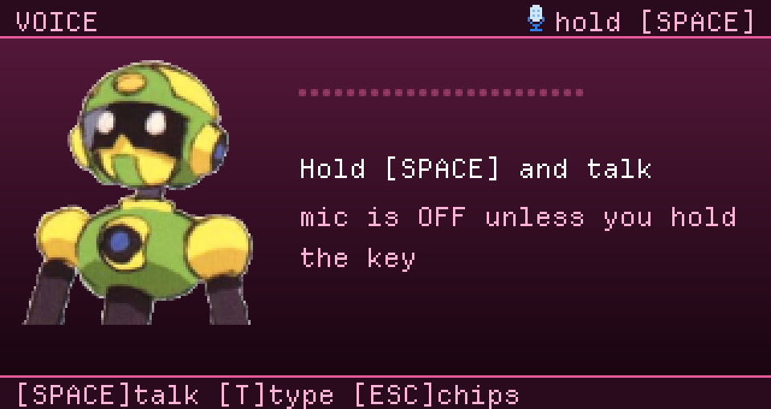

# AlicePET OS ⚡🐇

A Mega Man Battle Network-style **P.E.T.** (PErsonal Terminal) app for the
[M5Stack CardputerZero](https://github.com/CardputerZero). It turns the pocket
Linux computer into a home for your **NetNavi**: an AI agent running in
OpenClaw on a computer you own. You type or talk to your
Navi on the PET, and you slot **Battle Chips** that each open a small tool
(SSH terminal, Jellyfin player, network tester, IR remote, retro games, and a
USB sidekick for PCs).

It was built for one Navi, **Alice**, and her operator. Your Navi's name,
picture and your own name are settings, so it can be yours instead (see
[Making it yours](#making-it-yours)).

<p align="center">
  
  
</p>

> **Status:** active development, version 0.5.0. It runs daily on one
> CardputerZero. Some chips are tested only in the desktop simulator; see
> [HANDOFF.md](HANDOFF.md) for exactly what is proven on hardware and what is not.

## What you need

| Where | What |
|---|---|
| **The PET** | An M5Stack CardputerZero on its stock Debian 13 (trixie) image, with Wi-Fi and SSH working. AlicePET installs as an app that the stock launcher (APPLaunch) starts. |
| **Your Navi's computer** | A Mac or Linux machine that runs OpenClaw with an agent you want on the PET, plus Node.js 20 or newer. Optional for voice: `openai-whisper` (`pip install openai-whisper`). |
| **Between them** | A network path from the PET to that computer. [Tailscale](https://tailscale.com) on both is the easy way, and lets the PET reach your Navi away from home. |
| **To build** | A Linux machine (x86-64 or arm64) for cross-compiling, or any machine with Docker and SSH to one. There is no prebuilt download yet. |

Everything else is optional and per chip: a Jellyfin server, a RomM server,
SSH hosts, an IR transmitter.

## How it fits together

```
CardputerZero  (AlicePET app, C++ / LVGL)
   │  HTTP + JSON, bearer token, over Tailscale or your LAN
   ▼
Your computer: PET bridge   (bin/alicepet-bridge.sh → vendor/cardputer-pet-terminal/bridge)
   │  openclaw gateway call   (its own session, agent:main:pet by default)
   ▼
Your Navi  (an OpenClaw agent)
```

The bridge keeps PET chats in a session of their own, so they never show up in
your Navi's Telegram or other chats. Voice clips go to `/api/pet/voice` on the
same bridge and are transcribed on your computer with Whisper, not in the cloud.

## Install

### 1. Build the package

On a Linux machine:

```sh
git clone https://github.com/BingusDev/alicepet-os
cd alicepet-os/alicepet
sudo apt install g++-aarch64-linux-gnu ninja-build pkg-config dpkg-dev curl   # plus CMake 3.31 or newer
cmake --workflow --preset cp0-cross-package
```

The first configure downloads the CardputerZero SDK (about 435 MB) and LVGL into
`alicepet/.cache/`. The result is `alicepet/dist/AlicePET_0.5.0_<revision>_arm64.deb`.

No Linux machine handy? `BUILD_HOST=<ssh host> bin/build-device.sh alicepet --package`
(from the repo root) builds inside a `debian:trixie` Docker container on any SSH
host that has Docker, and copies the .deb back to `alicepet/dist/`.

### 2. Install it on the PET

Copy the package and the setup script over, then run the script on the PET:

```sh
scp bin/pet-setup.sh bin/volkeys.py alicepet/dist/AlicePET_*_arm64.deb <user>@<pet>:~
ssh -t <user>@<pet> 'sudo bash ~/pet-setup.sh ~/AlicePET_*_arm64.deb'
```

`pet-setup.sh` is safe to run again, and says what it changed at each step. It:

1. installs the .deb and the tools the chips use (mpv, ssh, curl, ALSA, iw and so on),
2. adds your user to the `input`, `video` and `audio` groups (keys, backlight, mic),
3. installs a narrow sudo rule for the Jack In USB switch and the clock setter,
4. builds the Jack In USB drive image,
5. creates `/etc/alicepet.local.conf` and asks for your Navi's name, your name,
   a Navi picture, and your bridge URL and token,
6. with `--usb-otg` only: switches the USB-C2 port to device mode for Jack In
   (this turns off USB-A and Ethernet; it backs up `config.txt` first),
7. fixes speaker audio and sets up the fn volume keys.

Reboot (or log out and in) so the group changes apply. AlicePET then shows up in
the launcher. To install a newer build later, run
`SKIP_BUILD=1 INSTALL=1 REMOTE_USER=<user> REMOTE_HOST=<pet> alicepet/deploy.sh`.

### 3. Start the bridge on your Navi's computer

Make a token once and keep it somewhere safe:

```sh
openssl rand -hex 24
```

Then start the bridge with your Navi's name:

```sh
PET_NAVI_NAME=<YourNavi> \
PET_BRIDGE_TOKEN=<token> \
BIND_HOST=$(tailscale ip -4) \
bin/alicepet-bridge.sh
```

| Variable | Default | What it does |
|---|---|---|
| `PET_NAVI_NAME` | `Alice` | The name your Navi answers as on the PET. |
| `PET_SESSION_KEY` | `agent:main:pet` | The OpenClaw session PET chats go to. Use `agent:<agent id>:pet` if your Navi is not the `main` agent. |
| `PET_BRIDGE_TOKEN` | (none) | Required for any address other than 127.0.0.1. The PET sends it with every request. |
| `BIND_HOST` | `127.0.0.1` | Where the bridge listens. Your Tailscale address is the safe choice. |
| `PET_BRIDGE_PORT` | `8797` | The bridge port. |
| `PET_VOICE_PROMPT` | Alice's vocabulary | Words Whisper should expect, such as your Navi's name, your name and your host names. Set this for good voice transcription. |
| `PET_VOICE_MODEL` | `large-v3-turbo` | Whisper model for push-to-talk. |

The bridge runs in the foreground; stop it with Ctrl-C. Use your OS's service
manager (launchd, systemd) if you want it to start on boot.

### 4. Point the PET at the bridge

If you skipped the questions in `pet-setup.sh`, edit `/etc/alicepet.local.conf`
on the PET:

```ini
[bridge]
url=http://<your-computer>.<tailnet>.ts.net:8797
token=<token>
```

Open AlicePET, type on Navi Home and press Enter. Your Navi should answer.

## Configure

AlicePET reads two files on the PET:

- `/etc/alicepet.conf` ships with the app and has every option, commented. It
  holds no personal hosts or secrets.
- `/etc/alicepet.local.conf` is yours. It is read second, its values win, and its
  `host=` lines are added to the shipped ones. Put your servers, tokens and API
  keys here, and keep it `chmod 640` (`pet-setup.sh` does that).

The main sections:

| Section | For |
|---|---|
| `[bridge]` | your Navi's bridge URL and token |
| `[netscan]` | hosts NET SCAN checks: `host=Router|192.168.1.1|tcp:80` |
| `[terminal]` | SSH bookmarks: `host=nas|me@192.168.1.20|NAS` (the PET uses its own SSH key) |
| `[jellyfin]` | server `url`, `api_key`, and an optional non-admin `pc_user` / `pc_password` for Jack In playback |
| `[romm]`, `[retro]` | RomM server and token, RetroArch cores, save sync |
| `[remote]` | IR transmitter and receiver devices for the REMOTE chip |
| `[lantech]` | interface and speed test settings for LAN TECH |
| `[navi]` | your Navi's name and picture, and your name (see [Making it yours](#making-it-yours)) |
| `[jackin]` | Jack In ports, `operator=` (defaults to your `[navi] owner`) and reports |
| `[voice]`, `[power]`, `[clock]` | recording and speech, sleep and dimming, clock syncing |

## Using it

| Key | Where | Does |
|---|---|---|
| type, Enter | Navi Home | chat with your Navi; arrows page through long replies |
| hold SPACE | Navi Home, VOICE | push-to-talk (the mic only records while it is held) |
| `1` | Navi Home | Chip Folder: pick a chip, Enter slots it |
| `2` | Navi Home | NET SCAN |
| `3` | Navi Home | VOICE |
| ESC | anywhere | back; on Home it sleeps the screen (any key wakes) |

### Battle Chips

| Chip | What it does | Tested |
|---|---|---|
| **VOICE** | Push-to-talk to your Navi, transcribed on your computer | on the PET |
| **TERMINAL** | SSH bookmarks with a built-in terminal; "Ask" has your Navi suggest one command, which runs only if you press Enter | on the PET |
| **JELLYFIN** | Browse your library and play it, transcoded down for the 320×170 screen | on the PET |
| **RETRO** | Your RomM library, downloads, RetroArch with per-platform cores, save sync | on the PET; save sync not yet against a live RomM |
| **LAN TECH** | Wall-jack tester: link, DHCP, gateway, DNS, speed, switch port, device list with "who's new" | simulator |
| **REMOTE** | Learn and replay IR remotes and macros with LIRC `ir-ctl` | simulator |
| **JACK IN** | Plug the PET into a PC by USB: it scans the PC, your Navi suggests fixes, and the PC app can chat, play Jellyfin and RetroArch, and drive chips | Windows on a real PC; macOS and Linux only against a test stand-in |

**Jack In and security:** once a PC is linked, it can open chips, talk to your
Navi and use the Terminal chip (with the PET's SSH keys) without a key press on
the PET. Only jack into PCs you trust. Changes on the PC (Full Access, admin,
sharing the PC's internet) are always clicked on the PC itself. Setup:
[alicepet/jackin/SETUP-GADGET.md](alicepet/jackin/SETUP-GADGET.md).

<p align="center">
  
  
  
</p>

## Making it yours

Your Navi's name and picture and your own name are settings. `pet-setup.sh`
asks for them, or put them in `/etc/alicepet.local.conf`:

```ini
[navi]
name=Norm
owner=Holden
picture=/home/pi/norm.png
```

- `name`: up to 12 characters. It shows as NORM.EXE, "Ask Norm" and "Norm: ...".
- `owner`: your name, up to 16 characters. It's used for "Hi Holden!", as the Jack In
  operator, and to tell your Navi who it is helping. Leave it empty to use no name.
- `picture`: any PNG, scaled to 110×110 and 44×44. Leave it empty for the packaged art.

Restart AlicePET (leave and reopen it from the launcher) to see the change.
On your Navi's computer, start the bridge with the same name
(`PET_NAVI_NAME=Norm`), so your Navi answers as Norm.

<p align="center">
  
  
</p>

A transparent background looks best for the picture. Make sure the PET's user
can read the file.

Still built in:

- The Jack In apps on the PC (Windows, macOS, Linux) still say "Alice" and
  show their own copy of Alice's picture.
- The app is named AlicePET in the launcher.

## Development

**Desktop simulator** (needs CMake 3.31+, Ninja, SDL2, FreeType, libpng,
libjpeg, zlib, fmt):

```sh
cd alicepet
cmake --preset linux-x86-64 && cmake --build --preset linux-x86-64-dbg   # or darwin-arm64 / darwin-arm64-rel
./build/linux-x86-64/Debug/alicepet
ctest --test-dir build/linux-x86-64 -C Debug
```

The simulator reads `alicepet/config/alicepet.conf` and then
`alicepet/config/alicepet.local.conf` (git-ignored). `ALICEPET_SNAPSHOT=<dir>`
renders screens to PNGs without a window; [alicepet/README.md](alicepet/README.md)
lists the snapshot switches, the source layout and the CMake options.

```
alicepet/        the app (CMake, LVGL; src/{app,model,view,viewmodel,platform}, tests/)
  config/        alicepet.conf, installed as /etc/alicepet.conf
  jackin/        the Jack In PC apps (Windows, macOS, Linux) and USB gadget script
bin/             pet-setup.sh, alicepet-bridge.sh, voice-route.mjs, build-device.sh, device-day.sh
vendor/          the PET bridge (from cardputer-pet-terminal)
mockups/         approved designs; chip art is rendered from chips.html
CHIPS.md         the Battle Chip folder and ideas
HANDOFF.md       current status for whoever picks this up next
```

## Secrets

The repo has none and should never get any. Tokens and API keys live only in
`/etc/alicepet.local.conf` on the PET and in the bridge's environment on your
computer.

## Credits

- Inspired by *Mega Man Battle Network* (Capcom). This is an unofficial fan
  project and is not affiliated with Capcom.
- [Departure Mono](https://departuremono.com/) font, SIL Open Font License.
- Built on the M5Stack CardputerZero app template and [LVGL](https://lvgl.io).
- License: MIT (see [alicepet/LICENSE](alicepet/LICENSE)).
