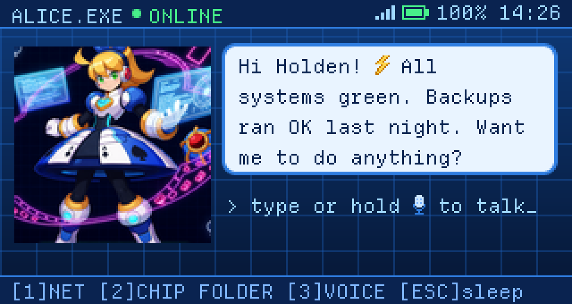
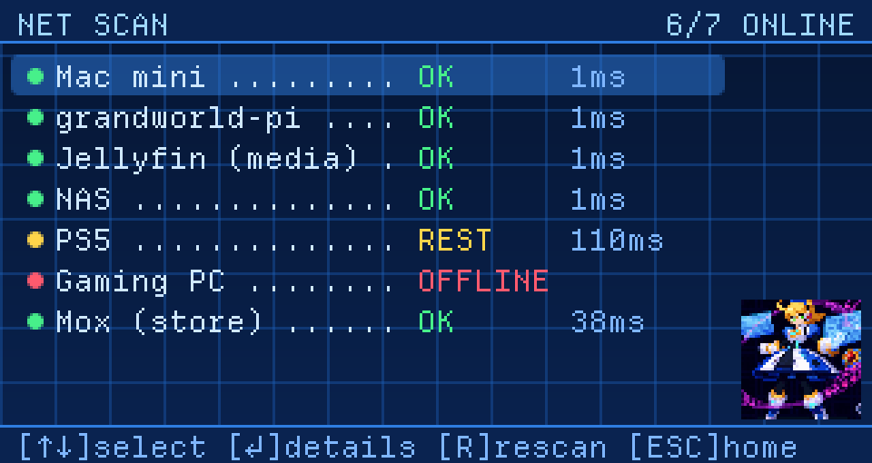
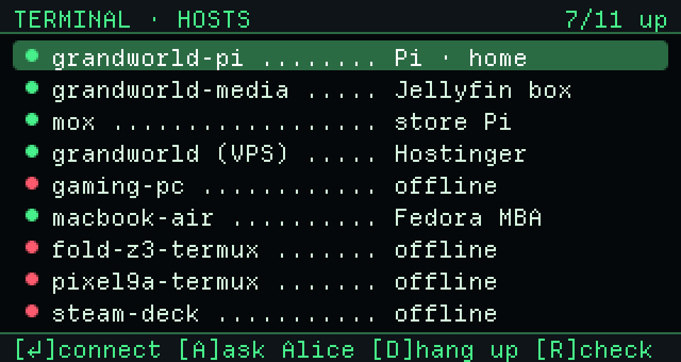
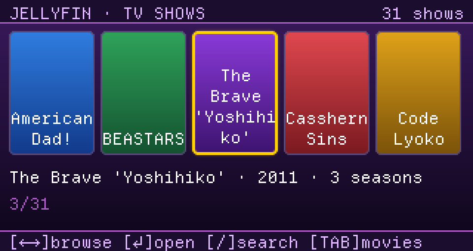

# AlicePET OS ⚡🐇

A Mega Man Battle Network-style **P.E.T.** (PErsonal Terminal) for the
[M5Stack CardputerZero](https://github.com/CardputerZero). It turns the
pocket Linux computer into a home for **Alice**, an OpenClaw NetNavi running on
the Mac mini. You can chat with her, run quick network checks, and slot
**Battle Chips** that each open a small tool.

<p align="center">
  
  
</p>

> **Status:** active development. Everything below runs in the desktop
> simulator. It hasn't run on real CardputerZero hardware yet. See
> [HANDOFF.md](HANDOFF.md) for the full current state.

## Features

| Screen | What it does | State |
|---|---|---|
| **Boot** | P.E.T. splash, connects to the Navi over Tailscale | ✅ |
| **Navi Home** | Alice portrait, status bar (signal, battery, clock); type to chat with Alice | ✅ |
| **[1] NET SCAN** | Checks home/store hosts in parallel; OK / REST / OFFLINE | ✅ |
| **[2] Chip Folder** | MMBN cartridge carousel; ENTER slots a chip | ✅ |
| **Sleep** | ESC or idle turns the backlight off; any key wakes | ✅ |
| **VOICE** chip | Push-to-talk → local Whisper on the Mac → Alice replies | ✅ |
| **TERMINAL** chip | SSH bookmarks, built-in VT100 view, "Ask Alice" command suggestions (run only on Enter) | ✅ |
| **JELLYFIN** chip | Browse library → seasons → episodes; low-bitrate H.264 to the 320×170 panel via mpv | ✅ (desktop playback stubbed) |
| **LAN TECH** chip | Wall-jack tester: link, DHCP, gateway, DNS, speed, switch port; static-IP fallback, saved reports, device list with "who's new", ping and open ports | ✅ (not yet on hardware) |
| **JACK IN** · **REMOTE** · **RETRO** | PC sidekick, IR learn/replay, RomM games | ⏳ planned |

<p align="center">
  
  
  
</p>

## How it fits together

```
CardputerZero (AlicePET, C++/LVGL)
   │  HTTP JSON over Tailscale (bearer token)
   ▼
Mac mini: PET bridge  (bin/alicepet-bridge.sh → vendor/cardputer-pet-terminal/bridge)
   │  openclaw gateway call  (session agent:main:pet)
   ▼
Alice (OpenClaw)
```

The bridge listens on localhost only by default. To bind to a Tailscale
address you have to set `PET_BRIDGE_TOKEN`. Voice uploads go to
`/api/pet/voice` (`bin/voice-route.mjs`) and are transcribed on the Mac.

## Repo layout

```
alicepet/        the app (CMake, LVGL; src/{app,model,view,viewmodel,platform})
  config/        alicepet.conf (installed to /etc/alicepet.conf; holds no secrets)
  assets/        fonts (Departure Mono, OFL), chip PNGs, icons
  screenshots/   desktop-simulator captures
mockups/         approved designs (HTML + PNG); chip art is rendered from chips.html
bin/             build-device.sh, alicepet-bridge.sh, voice-route.mjs
vendor/          the PET bridge (from cardputer-pet-terminal)
CHIPS.md         the Battle Chip folder and ideas
BUILD-PLAN.md    roadmap
NOTES.md         install and test checklist
HANDOFF.md       current status for whoever picks this up next
```

## Building

**Desktop simulator (macOS arm64):**

```sh
cd alicepet
cmake --preset darwin-arm64
cmake --build --preset darwin-arm64-rel
```

**Device (aarch64 `.deb`):**

```sh
cd alicepet
cmake --workflow --preset cp0-cross-package   # on a Linux/arm64 or cross-capable host
```

You can also run `bin/build-device.sh alicepet`, which builds remotely inside
a `debian:trixie` container. Edit the ssh host first. It prints `BUILD_OK` on
success.

The first configure downloads the CardputerZero BSP/SDK (~435 MB) and LVGL. Both go
into `alicepet/.cache/` and aren't committed.

## Installing on the PET

1. Get the CardputerZero onto Wi-Fi + Tailscale with SSH access.
2. `SKIP_BUILD=1 INSTALL=1 REMOTE_USER=<user> REMOTE_HOST=<pet> ./alicepet/deploy.sh`
3. On the Mac, start the bridge with a token:
   `BIND_HOST=$(tailscale ip -4) PET_BRIDGE_TOKEN=<token> bin/alicepet-bridge.sh`
4. On the PET, put `token=<token>` (and the Jellyfin `api_key=` if you use it) in
   `/etc/alicepet.conf`, then run `chmod 640 /etc/alicepet.conf`.

## Secrets

The repo has none. Tokens and API keys live only in `/etc/alicepet.conf` on
the device and in the bridge's environment on the Mac. Don't commit them.

## Credits

- Inspired by *Mega Man Battle Network* (Capcom). This is an unofficial fan project.
- [Departure Mono](https://departuremono.com/) font, SIL Open Font License.
- Built on the M5Stack CardputerZero app template and LVGL.
